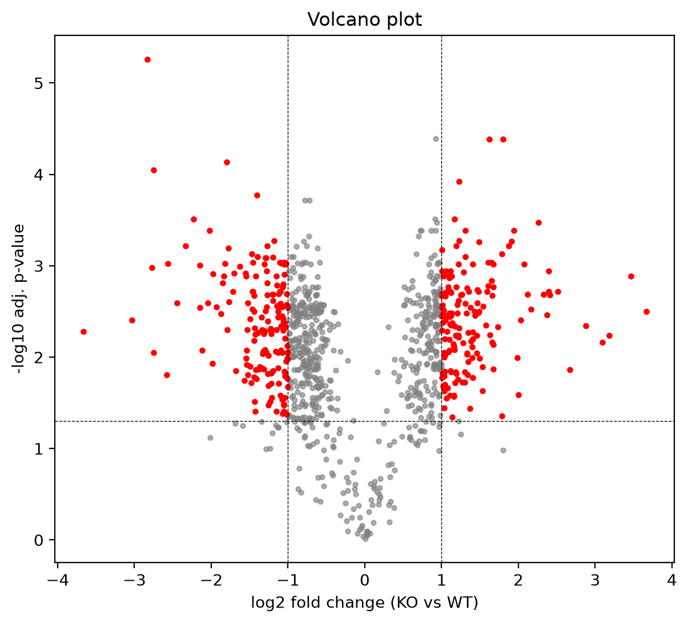
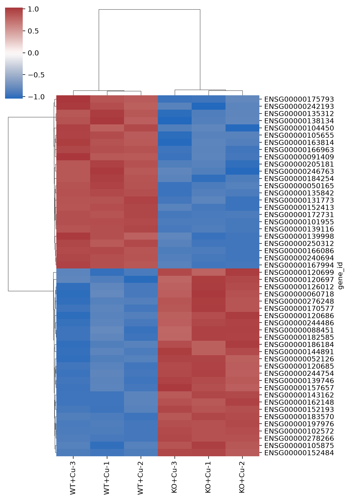

# Differential Expression Analysis (Python)

RNA-seq differential expression analysis of a public GEO dataset using PyDESeq2. The same analysis in R is here: [link to R repo].

## Dataset
- **Source:** GEO [GSE_____]
- **Comparison:** [condition A] vs. [condition B]
- **Samples:** [n] per group

## What it does
- Loads the count matrix and sample metadata
- Filters low-count genes
- Runs differential expression with PyDESeq2
- Makes a volcano plot and a heatmap of the top 50 genes
- Runs pathway enrichment on the significant genes

## Usage
```bash
pip install -r requirements.txt
python3 src/de_analysis.py
```
Outputs are saved to `results/`.

## Results



- [X] genes significant (adj. p < 0.05, |log2FC| > 1)
- Most upregulated: [gene]
- Most downregulated: [gene]
- Enrichment: [top pathways]

## Notes
- Genes with fewer than 10 total counts were removed. I didn't tune this threshold.
- [One limitation or thing you'd do differently]

## Tools
Python, pandas, NumPy, PyDESeq2, matplotlib, gseapy