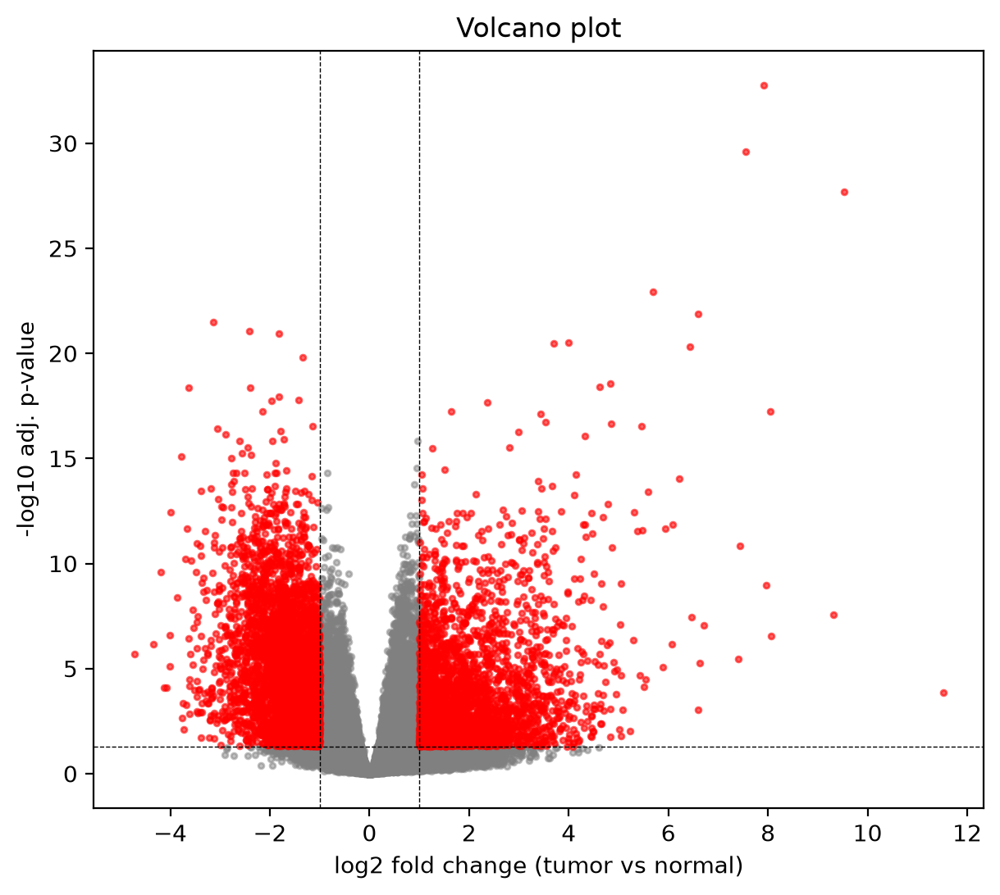

# Differential Expression Analysis (Python)

I ran a differential expression analysis on urothelial carcinoma tumors vs. normal tissue using PyDESeq2 and public RNA-seq data from GEO. 

## Dataset
Data is from GEO [GSE353851](https://www.ncbi.nlm.nih.gov/geo/query/acc.cgi?acc=GSE353851), the OMPU-NCC Urothelial Carcinoma Cohort. I used the gene-level raw read counts and the sample annotation file, which gives 552 tumor samples and 35 normal samples.

The data files are too big for this repo, so you'll need to download them yourself (see Usage).

## What the script does
- Merges the normal and tumor count tables and matches them to the sample annotation
- Drops low-count genes (fewer than 10 counts in at least 10 samples)
- Runs PyDESeq2 comparing tumor to normal
- Makes a volcano plot and a heatmap of the top 50 genes

## Usage
Download these files from the GEO page, put them in a `data/` folder, and unzip them:
- GSE353851_RNA_raw_readcounts_normal.tsv.gz
- GSE353851_RNA_raw_readcounts_tumor.tsv.gz
- GSE353851_sample_annotation.tsv.gz

Then run:
```bash
pip install -r requirements.txt
python3 src/de_deseq2.py
```
Everything gets saved to `results/`.

## Results



I tested 44,736 genes and 7,650 were significant (adjusted p < 0.05 and |log2FC| > 1). The top genes higher in tumor were KRT6A, KRT6B, KRT16, CASP14, and SPP1. The top genes lower in tumor included PLPPR4, PTCH1, and LINC00926. The full table is in `results/deseq2_results.csv`.

## Notes
- The groups are really unbalanced (552 vs. 35). With this many samples, tiny differences can come out significant, so I also required a 2-fold change.
- I didn't adjust for age, sex, or tissue type. I'd like to add that next.
- Trimming, alignment, and quantification were already done by the original authors. I started from their count matrices.
- I picked the low-count filter quickly and didn't tune it. It took the gene list from 63,140 down to 44,736.
- I haven't done pathway enrichment yet.

## Tools
Python, pandas, NumPy, PyDESeq2, matplotlib, seaborn